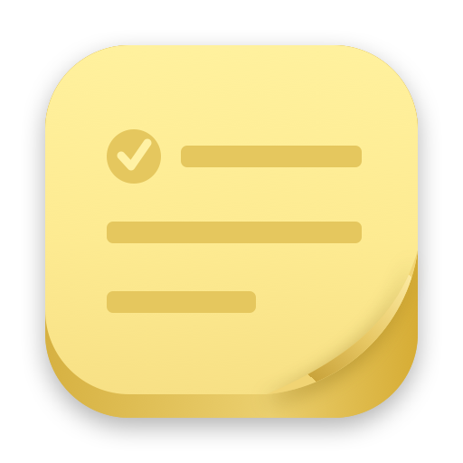

<div align="center">
  
  <h1>Haftnotiz</h1>
  <p><strong>Minimal sticky notes for macOS, written in plain Markdown.</strong></p>
</div>

Each note is a small floating paper note on the desktop, and the whole note is the writing
surface: no title field, no input box. Markdown is styled as you type, checkboxes can be ticked
with a click, and every note is a plain `.md` file in a folder of your choice. Haftnotiz runs
completely offline.

## Features

- **Sticky notes** with rounded corners and shadow, in six paper colours.
- **Pin** a note to keep it above other windows (per note), optionally on all Spaces.
- **Roll up** a note to its header with a double-click.
- **Simple Markdown**, styled live with the syntax kept visible: headings, `- ` bullets,
  numbered lists, `- [ ]` checkboxes (click to tick), quotes, `**bold**`, `*italic*`,
  `` `code` ``, `~~strike~~`, links and bare URLs.
- **Plain files:** one Markdown file per note (default `~/Vault/Wiredframe/Notizen/Haftnotiz`,
  changeable from the menu bar). A small YAML front matter keeps the creation date and colour.
  Other front matter (tags, lists, anything Obsidian adds) is kept untouched.
  Window position, pin and roll-up state stay on this Mac in
  `~/Library/Application Support/Haftnotiz/fenster.json`. Edits made in other apps show up live;
  deleting a note moves its file to the Trash.
- **Search** all notes from the menu bar (⇧⌘F while the menu is open).

## Keyboard

| Shortcut | Action |
| --- | --- |
| **⌘N** | New note |
| **Return** in a list | Next item (an empty item ends the list) |
| **Tab / ⇧Tab** in a list | Indent / outdent the item |
| **⌥↑ / ⌥↓** | Move the line (or all selected lines) up / down |
| **⇧⌘L** | Turn the line into a checkbox and back |
| **⌘B / ⌘I** | Bold / italic |
| **⌘F** | Find in the note |
| **⌘W** | Close the note (an empty note goes away) |

## Build

```sh
swift test
./build.sh            # build/Haftnotiz.app, signed with a Developer ID if one is available
./build.sh --install  # also copy to ~/Applications and launch
swift Scripts/make-icon.swift   # redraw Resources/AppIcon.icns
```

Requires macOS 14 or later (Apple silicon).

## Credits

The note window layer (borderless panels, multi-display placement, roll-up) and the colour palette
come from [Tic](https://github.com/kasvith/tic) by Kasun Vithanage, MIT licensed. See `LICENSE`.
